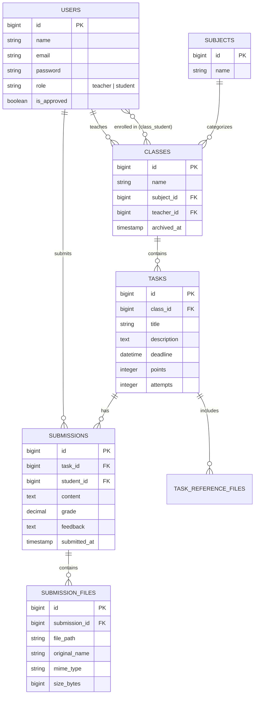

# 🎓 Assignment Submission App

A modern, robust, and feature-rich learning management system (LMS) built with Laravel. This application streamlines the process of creating classes, managing assignments, and handling student submissions with a focus on ease of use and performance.

---

## 🚀 Getting Started

### Prerequisites
- PHP 8.3 or higher
- Composer
- Node.js & NPM
- SQLite (or your preferred database)

### Installation Steps

1. **Clone the repository:**
   ```bash
   git clone <repository-url>
   cd Assisgment-Submission-App
   ```

2. **Install PHP dependencies:**
   ```bash
   composer install
   ```

3. **Install JavaScript dependencies:**
   ```bash
   npm install
   ```

4. **Environment Setup:**
   ```bash
   cp .env.example .env
   php artisan key:generate
   ```

5. **Database Configuration:**
   Ensure your `.env` file is configured for your database (default is SQLite). Create the database file if using SQLite:
   ```bash
   touch database/database.sqlite
   ```

6. **Run Migrations & Seeders:**
   ```bash
   php artisan migrate --seed
   ```

7. **Start the Application:**
   Run the development servers concurrently:
   ```bash
   composer run dev
   ```
   Or run them separately:
   ```bash
   php artisan serve
   # In another terminal:
   npm run dev
   ```

---

## ✨ Features

### 👨‍🏫 Teacher Dashboard
- **Class Management:** Create, view, and archive classes to organize your subjects.
- **Student Enrollment:** Easily add students to your classes.
- **Task Management:** Create assignments with detailed descriptions, deadlines, and reference materials.
- **Submission Review:** Monitor student submissions in real-time, provide feedback, and mark them as checked.
- **Calendar Integration:** Visualize all task deadlines in a central calendar view.

### 👨‍🎓 Student Dashboard
- **Class Overview:** View all enrolled classes and access course materials.
- **Assignment Tracking:** Stay on top of upcoming tasks and deadlines.
- **File Submissions:** Upload multiple files for a single assignment with version tracking.
- **Reference Materials:** Download files attached by teachers to help with assignments.
- **Personal Calendar:** Track your own deadlines and submission statuses.

---

## 📊 Database Schema (ERD)



---

## 👥 Group Members (OneDev Team)

- **Earl Ordovez** - Project Lead
- **Nikolai Roman Nepomuceno** - Developer I
- **Paulo Cordova** - Developer II
- **Marina Camaso** - UI Designer
- **Aaron Paul Sario** - QA Tester
- **Seann Patrick Tamondong** - QA Tester


---

## 🛡️ License

This project is open-sourced software licensed under the [MIT license](https://opensource.org/licenses/MIT).
